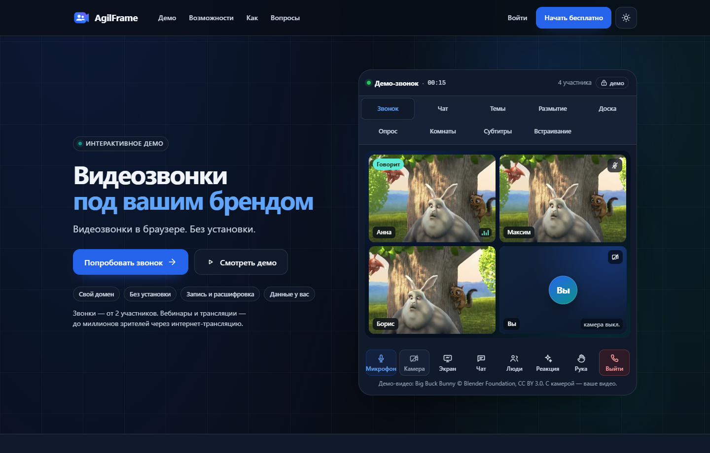
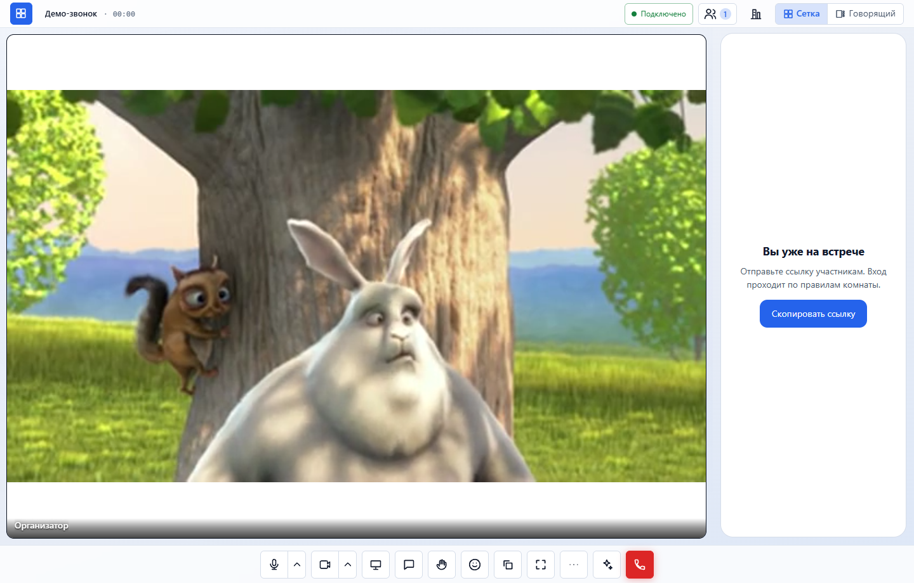

<p align="center">
  <picture>
    <source media="(prefers-color-scheme: dark)" srcset="https://raw.githubusercontent.com/GillHD/agilframe-core/main/agil/websdk/demo/public/branding/agil-logo-on-dark.png">
    
  </picture>
</p>

# AgilFrame

[Русский](README.md) · **English**

**Self-hosted WebRTC video calls, live streams, and voice rooms.** Embed the call interface in an intranet, learning platform, or customer-facing application. Use the SDK and API to build a custom interface.

AgilFrame lets you configure participant access, branding, and data handling.

[Website and demo](https://agilframe.online/) · [Wiki](https://calls.guardify.ru/wiki/) · [API reference](https://calls.guardify.ru/docs) · [OpenAPI specification](https://calls.guardify.ru/openapi.json)

[Get started](#get-started) · [Documentation index](https://github.com/GillHD/agilframe-core/blob/main/docs/README.en.md) · [GitHub project](https://github.com/users/GillHD/projects/1) · [Contributing](CONTRIBUTING.en.md)

## Screenshots

**Landing page with interactive demo**



**Browser-based call**



Demo footage from Big Buck Bunny © 2008 Blender Foundation, CC BY 3.0. [Attribution and license](https://agilframe.online/media/NOTICE.md)

## Repositories

| Component | What it contains |
| --- | --- |
| [Core](https://github.com/GillHD/agilframe-core/blob/main/README.en.md) | Node.js server, REST and WebSocket APIs, tenant and access management, dashboard, call editor, and Wiki |
| [Web SDK](https://github.com/GillHD/agilframe-websdk/blob/main/README.en.md) | Browser widget, Web SDK, Web Component, and client contracts |
| [Mobile SDK](https://github.com/GillHD/agilframe-mobile/blob/main/README.en.md) | Android, iOS, Flutter, Capacitor, and React Native integrations |
| [Media nodes](https://github.com/GillHD/agilframe-nodes/blob/main/README.en.md) | LiveKit SFU, TURN, Node Agent, and media service images, including speech-to-text |
| [Edge](https://github.com/GillHD/agilframe-edge/blob/main/README.en.md) | Node.js and FFmpeg agent for embedded Linux that publishes MP4 media to a room over RTMP or RTMPS |
| [Deploy](https://github.com/GillHD/agilframe-deploy/blob/main/README.en.md) | Docker Compose setup for self-hosting Core |
| [Examples](https://github.com/GillHD/agilframe-examples/blob/main/README.en.md) | Runnable example of embedding a room in an application |

## Get started

- **Run your own instance.** Follow the Docker Compose setup. [Deploy](https://github.com/GillHD/agilframe-deploy/blob/main/README.en.md)
- **Try an integration.** Start Core, create a room, and pass a participant token to the web example. [Examples](https://github.com/GillHD/agilframe-examples/blob/main/README.en.md)
- **Develop across components.** Clone this repository with its submodules.

```sh
git clone --recurse-submodules https://github.com/GillHD/agilframe.git
cd agilframe
```

The checkout contains `core/`, `websdk/`, `mobile/`, `nodes/`, `edge/`, `deploy/`, and `examples/`. You can also clone any component independently. The submodules and release manifest pin the component revisions. [Release manifest](versions.json) · [Update component versions](docs/repositories.en.md#update-component-versions)

## How AgilFrame works

Core issues participant tokens, checks access, and selects the media route. Clients transmit audio, video, and screen sharing over WebRTC, either directly or through an SFU. TURN relays traffic when WebRTC selects a relay connection. Server-side recording, HLS streaming, and speech-to-text use dedicated media services. [Core architecture (Russian)](https://github.com/GillHD/agilframe-core/blob/main/agil/core/docs/architecture.md) · [Scaling (Russian)](https://github.com/GillHD/agilframe-core/blob/main/agil/core/docs/scaling.md)

## License

AgilFrame source code is available under PolyForm Noncommercial 1.0.0. Commercial use requires a separate agreement. Third-party components are subject to their own terms. [License](LICENSE) · [Commercial licensing (Russian)](https://github.com/GillHD/agilframe-core/blob/main/agil/core/docs/commercial-license.md) · [Notices](NOTICE)
