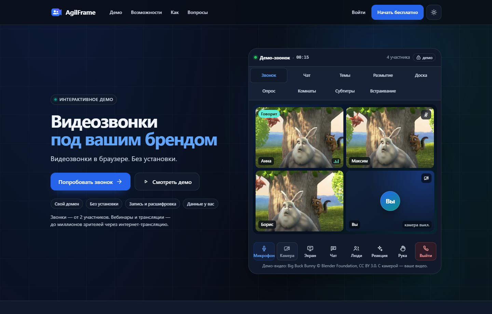
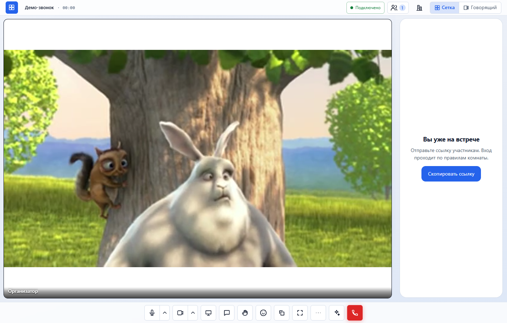

<p align="center">
  <picture>
    <source media="(prefers-color-scheme: dark)" srcset="https://raw.githubusercontent.com/GillHD/agilframe-core/main/agil/websdk/demo/public/branding/agil-logo-on-dark.png">
    
  </picture>
</p>

# AgilFrame

Русский · [English](README.en.md)

**AgilFrame добавляет видеозвонки, трансляции и голосовые комнаты в ваши приложения.** Встройте готовый виджет в корпоративный портал, учебную платформу или клиентский сервис. Для собственного интерфейса используйте Web SDK и API.

AgilFrame развёртывается на вашей инфраструктуре. В панели администратора задаются права доступа и правила обработки данных, а в визуальном редакторе — оформление окна звонка.

[Попробовать демо](https://agilframe.online/) · [Открыть вики](https://calls.guardify.ru/wiki/) · [Справочник API](https://calls.guardify.ru/docs) · [OpenAPI JSON](https://calls.guardify.ru/openapi.json)

[Начать работу](#начать-работу) · [Документация в репозитории](https://github.com/GillHD/agilframe-core/blob/main/docs/README.md) · [Доска проекта](https://github.com/users/GillHD/projects/1) · [Как внести вклад](CONTRIBUTING.md)

## Скриншоты





Демонстрационное видео Big Buck Bunny © 2008 Blender Foundation, CC BY 3.0. [Условия использования](https://agilframe.online/media/NOTICE.md)

## Репозитории

| Компонент | Назначение |
| --- | --- |
| [Core](https://github.com/GillHD/agilframe-core) | Сервер на Node.js, API, управление организациями и правами доступа, панель администратора, редактор звонков и вики |
| [Web SDK](https://github.com/GillHD/agilframe-websdk) | Веб-виджет, SDK для собственного интерфейса, веб-компонент и клиентские контракты |
| [Мобильные SDK](https://github.com/GillHD/agilframe-mobile) | Комплекты средств разработки для Android, iOS, Flutter, Capacitor и React Native |
| [Медианоды](https://github.com/GillHD/agilframe-nodes) | LiveKit SFU, TURN, Node Agent и образы сервисов обработки медиа, включая распознавание речи |
| [Edge](https://github.com/GillHD/agilframe-edge) | Агент для встраиваемых устройств под управлением Linux. Передаёт MP4 в комнату через RTMP или RTMPS с помощью FFmpeg |
| [Развёртывание](https://github.com/GillHD/agilframe-deploy) | Конфигурация Docker Compose для установки Core |
| [Примеры](https://github.com/GillHD/agilframe-examples) | Самостоятельный веб-пример подключения к комнате |

## Начать работу

- **Установить Core.** Запустите платформу на своём сервере по инструкции для Docker Compose. [Развёртывание](https://github.com/GillHD/agilframe-deploy)
- **Проверить интеграцию.** Запустите Core, создайте комнату и используйте токен участника в веб-примере. [Пример встраивания](https://github.com/GillHD/agilframe-examples)
- **Скачать все компоненты для разработки.** Клонируйте этот репозиторий с подмодулями.

```sh
git clone --recurse-submodules https://github.com/GillHD/agilframe.git
cd agilframe
```

Git загрузит компоненты в каталоги `core/`, `websdk/`, `mobile/`, `nodes/`, `edge/`, `deploy/` и `examples/` на закреплённых коммитах. Каждый компонент можно клонировать отдельно. [Манифест версий](versions.json) · [Порядок обновления компонентов](docs/repositories.md)

## Как работает AgilFrame

Core выдаёт токены участникам, проверяет права доступа и выбирает медиамаршрут. Клиенты передают аудио, видео и демонстрацию экрана по WebRTC напрямую либо через SFU. TURN ретранслирует трафик, когда выбран релейный маршрут. Серверная запись, трансляции HLS и распознавание речи требуют соответствующих медиасервисов. [Архитектура Core](https://github.com/GillHD/agilframe-core/blob/main/agil/core/docs/architecture.md) · [Масштабирование](https://github.com/GillHD/agilframe-core/blob/main/agil/core/docs/scaling.md)

## Лицензия

Собственный код AgilFrame доступен на условиях PolyForm Noncommercial 1.0.0. Коммерческое использование лицензируется отдельно. Для сторонних компонентов действуют их собственные условия. [Лицензия](LICENSE) · [Коммерческое использование](https://github.com/GillHD/agilframe-core/blob/main/agil/core/docs/commercial-license.md) · [Уведомления](NOTICE)
